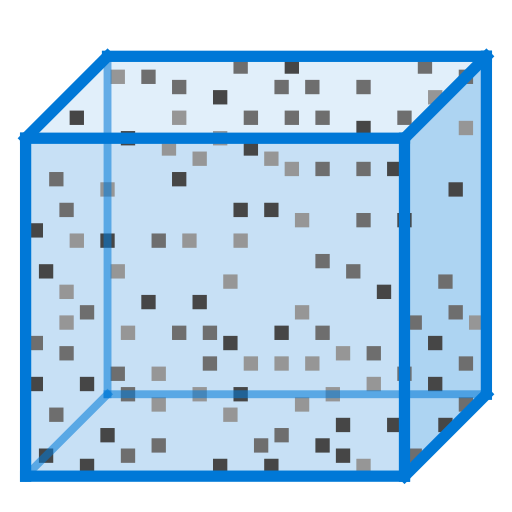
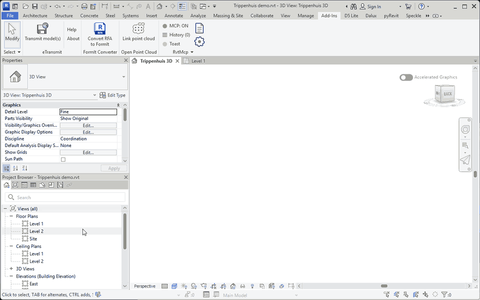
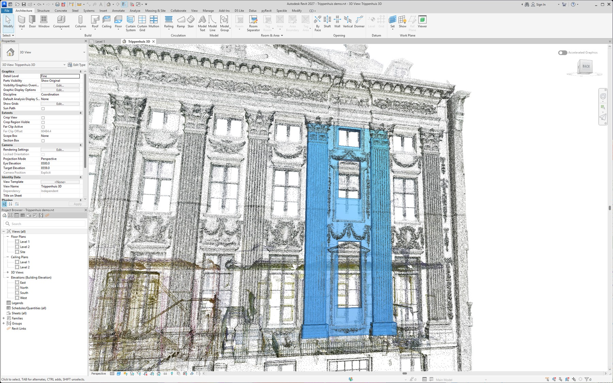

<p align="center"></p>

<h1 align="center">Open Point Cloud for Revit</h1>

<p align="center"><a href="https://github.com/jdwit/revit-open-pointcloud/actions/workflows/build.yml"></a> <a href="LICENSE"></a></p>

Revit can only read point clouds in the ReCap format natively. This format is closed, and many of us prefer to work with open formats such as PLY and use [CloudCompare](https://github.com/CloudCompare/CloudCompare). This Revit add-in gives you a direct way to get open-format point clouds into Revit, without any bells and whistles. Just link a PLY and model on it.





Point cloud: "2025 Trippenhuis gevel" by the Cultural Heritage Agency of the Netherlands (Rijksdienst voor het Cultureel Erfgoed), [CC BY 4.0](https://creativecommons.org/licenses/by/4.0/), via [Sketchfab](https://sketchfab.com/3d-models/2025-trippenhuis-gevel-868760e44f764273ab9224a2ee3fcc10). The GIF uses a copy cropped to the facade and converted to E57.

## Features

- Links a binary PLY or an E57 file as a Revit point cloud, with colour.
- Reads all scans in an E57 file and applies the position of each scan. Without colour, the add-in uses the intensity as grey.
- Large coordinates (for example national grid coordinates) keep their full precision.
- The first link makes a spatial index next to the file (for example `<name>.ply.opc`). The next link takes less than a second.
- If the file is in Downloads, on the desktop or in a temporary folder, the add-in offers to copy it to the project folder.
- Works in Revit 2025, 2026 and 2027.

The linked cloud is a native Revit point cloud. Revit already supports point clouds well. Views, crop regions and section boxes cut the cloud. You can snap to points, and Move and Rotate align the cloud.

## Install

1. Download `OpenPointCloud-<version>.zip` from [Releases](https://github.com/jdwit/revit-open-pointcloud/releases) and extract it.
2. Close Revit.
3. In the extracted folder, run:
   ```
   powershell -ExecutionPolicy Bypass -File .\install.ps1
   ```
   For each Revit version on the computer, the script copies `OpenPointCloud.addin` and the folder `OpenPointCloud` to `%AppData%\Autodesk\Revit\Addins\<version>`.
4. Start Revit. Revit asks one time about the unsigned add-in. Click "Always Load".

To remove the add-in, close Revit and run `install.ps1` with `-Uninstall`.

## Use

1. Click Add-Ins > Open Point Cloud > Link point cloud.
2. Select a `.ply` or `.e57` file. The add-in links the cloud, selects it and zooms to it.
3. Align the cloud with Move and Rotate.

Other formats (for example LAS and LAZ): open them in CloudCompare and save as binary PLY.

## Agents and scripting

I designed the add-in for agents and scripts too. A public API links a PLY or E57 file without dialogs and returns a JSON summary. The skill [`skills/open-point-cloud/SKILL.md`](skills/open-point-cloud/SKILL.md) tells an agent how to use it.

## Build

You need the .NET 10 SDK. For Revit 2025 and 2026 you also need the .NET 8 targeting pack. You do not need Revit: the Revit API reference assemblies come from NuGet.

```
dotnet build -c Release src/OpenPointCloud -p:RevitVersion=2027
```

The output goes to `src/OpenPointCloud/bin/Release/<version>`. Run the unit tests with `dotnet test OpenPointCloud.slnx`. GitHub Actions builds all three versions and runs the tests for each push.

Quality checks run as pre-commit hooks and in GitHub Actions: whitespace and line endings, YAML, `dotnet format`, and lowercase conventional commit messages (`feat: ...`, `fix: ...`).

```
pip install pre-commit
pre-commit install
```

## Roadmap

- [x] Link a binary PLY with colour as a Revit point cloud
- [x] Spatial index, cached next to the PLY
- [x] Full precision for large coordinates
- [x] Select and zoom after the link, copy offer for a PLY in a temporary folder
- [x] Builds for Revit 2025, 2026 and 2027
- [x] Support the E57 input format (`specs/03-e57-input.md`)
- [ ] Indicate the distance from the cloud to the model (`specs/04-distance-to-model.md`)

Specs for each feature: `specs/`.

## Disclaimer

Revit and ReCap are trademarks of [Autodesk, Inc.](https://www.autodesk.com) This project works in Revit, but it is not an Autodesk product. Autodesk does not endorse or support it.
